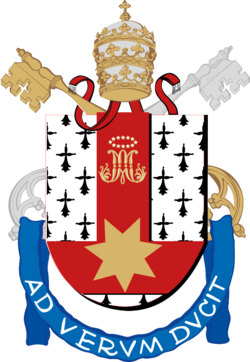

<!-- Intro -->
<h1>Hi, I'm João Jacques 👋</h1>

Brazilian developer and Systems Analysis and Development student at PUCRS.
I'm passionate about software engineering, data science, web development and all kinds of innovation.
I'm currently working on several projects alongside my studies, always looking for opportunities to practice and expand my knowledge.

<!-- Current role -->
<h2>Current role</h2>
<table>
  <tr>
    <td align="center" width="140">
      
    </td>
    <td>
      <b>Developer, Web Apps and AI Projects</b> 
      Building algorithms for chronic disease prevention and risk classification, using a range of technologies to deliver impactful solutions.
    </td>
  </tr>
</table>

<!-- Featured projects: uncomment and fill in. Private projects can be shown with a description and a screenshot.
<h2>Featured projects</h2>
<table>
  <tr>
    <td width="50%">
      <b>Project name</b> 
      Short description of the problem and what you built. 
      Python · React Native · AWS
    </td>
    <td width="50%">
      
    </td>
  </tr>
</table>
-->

<!-- Technologies -->
<h2>Technologies I work with or am studying</h2>

  

<!-- Education -->
<h2>Education and specialization</h2>
<table>
  <tr>
    <td align="center" width="140">
      
    </td>
    <td>
      <b>Systems Analysis and Development</b> 
      PUCRS, 2024 – 2027
    </td>
  </tr>
  <tr>
    <td align="center" width="140">
      
    </td>
    <td>
      <b>Python Specialization</b> 
      Coursera, offered by the University of Michigan, 2024
    </td>
  </tr>
</table>

<!-- GitHub stats: regenerated daily by .github/workflows/metrics.yml (includes private repositories) -->
<h2>GitHub stats</h2>

Much of my work lives in private repositories, and these stats include them.

  

<!-- Contribution snake: regenerated by .github/workflows/snake.yml -->
<picture>
  <source media="(prefers-color-scheme: dark)" srcset="https://raw.githubusercontent.com/Joao-Jacques/Joao-Jacques/output/github-snake-dark.svg">
  
</picture>

<!-- Contact -->
<h2>Where to find me</h2>

  
  

